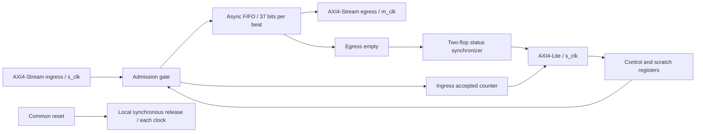

# AXI4-Stream CDC subsystem

My project connects two independent clock domains with a 32-bit stream, `TKEEP` and `TLAST`, an asynchronous FIFO, and an AXI4-Lite register bank. The subsystem buffers streams across clocks and provides control/status registers; memory-master transfers are outside its scope.

Read the [bounded specification and register map](SPEC.md) first. The implementation uses two domains: ingress plus AXI-Lite on `s_clk`, and stream egress on `m_clk`. `DEPTH` defaults to 16 and supports powers of two >=4. Both tested depths are listed below.



Disabling admission deasserts ingress ready while allowing queued output to drain. A stalled output remains valid and stable independently of the control bit. AW and W have separate capture registers; neither is required to arrive first. Read and write response channels operate independently, hold under stalls, and can insert bubbles. Writable registers honor byte strobes, and unsupported/misaligned accesses or writes to read-only registers return SLVERR.

## Reproduce

My tested setup on Apple Silicon uses Icarus **13.0**, Verilator **5.048**, Yosys **0.66**, Python **3.9.6**. Dependencies are reported tested versions, not a hermetic lock; Homebrew versions may change. I use a self-checking SystemVerilog testbench here; this milestone does not use a commercial simulator, UVM, cocotb or hardware.

```sh
brew install icarus-verilog verilator yosys
bash scripts/check.sh        # lint + generic synthesis + 4 self-checking simulations
python3 scripts/negative.py  # 3 isolated defects must be detected
```

The shell script uses `set -euo pipefail`; mismatches and watchdog timeouts are fatal. A failed simulation is rerun with waveform recording in `build/failure.vcd`, retaining a failure exit. For manual replay: `vvp build/d4.vvp +SEED=1 +WAVES`. CI configuration runs these commands and uploads logs/failure waveforms, with CI results available in the repository Actions tab.

## Verification and measurements

[Recorded results and source hashes](docs/results/README.md) tie these observations to exact source files.

| Depth | Seed | Accepted ingress | Consumed egress | Reset discard | AXI-Lite transaction checks |
|---|---|---:|---:|---:|---:|
| 4 | 1 | 1626 | 1622 | 4 | 571 |
| 4 | 20260905 | 1620 | 1616 | 4 | 571 |
| 16 | 1 | 1777 | 1761 | 16 | 571 |
| 16 | 20260905 | 1771 | 1755 | 16 | 571 |

My regression passed all four simulations. These counts are operations/checks, not independent test cases or coverage percentages. The scoreboard compares the complete 37-bit beat at accepted events using separate monotonic indices, including simultaneous clock edges. Expected data is fully consumed at drains; reset discards are explicitly accounted. AXI-Lite request/response counters check unmatched responses and final accounting, with counters reset when outstanding transactions are intentionally abandoned by reset.

Exercised: bursts and randomized source/sink stalls, FIFO full, wraparound, disabled ingress with draining output, re-enable, clocks at 6/14 ns then 14/6 ns then 10/10 ns periods, pause of either clock, reset with buffered beats, pending AW, pending W, B and R responses. Register tests include all 16 strobe masks, AW-first/W-first/simultaneous timing, response stalls, concurrent reads/writes, same-address read/write returning the prior value, reserved control bits and a sweep of every invalid byte address. Protocol checks cover source/output payload hold and B/R response hold under backpressure.

In each simulation run, I measured: after warm-up with continuous source and sink at **6 ns ingress / 14 ns egress periods**, **200 beats transferred in 200 egress cycles over 2,800 ns** (1 beat/egress cycle). These are beat transfers; random TKEEP values mean this is not a measurement of 4 useful bytes per beat. Cold first-beat acceptance-to-acceptance latency was **40 ns** for the tested phase. Across all later scenarios, observed latency ranged from **13–534 ns**, including deliberate stalls and clock changes. These are simulator measurements, not Fmax, board bandwidth or universal latency bounds.

Verilator lint passed with the inherited, explicit `SYNCASYNCNET` reset waiver. Yosys generic synthesis and `check -assert` passed at default depth 16. I haven't completed mapped area analysis, timing closure or physical signoff. Three temporary mutations were detected with exit 1: gating output valid with ready, ignoring scratch byte strobes, and processing a write before both channels were captured. Temporary defects are never written into committed RTL.

## Reset and CDC integration

Common reset asynchronously asserts both local reset synchronizers. Hold it across at least two edges of both clocks; each domain releases synchronously. All peers must treat reset as abandonment of partial packets and outstanding register requests. No per-domain reset or software flush is provided. Reset clears bookkeeping, not the memory contents.

Only Gray FIFO pointers and the single-bit empty diagnostic cross domains. Empty status is delayed and non-atomic with other fields; software must not use it as a flush-completion handshake. CONTROL is local to ingress. Do not cross binary counters directly; this milestone deliberately reports only the ingress-domain accepted counter.

`ASYNC_REG` attributes are implementation hints. Apply target-specific Gray-bus max-delay/bus-skew constraints based on the fastest supported source clock, review exception precedence and synchronizer placement, and perform actual CDC/reset/timing analysis. A broad asynchronous clock exception alone is insufficient. Digital simulation does not establish analog metastability behavior. The FIFO's combinational read array may become registers/muxes; target block-RAM inference is not established.

## Limits and next extensions

No subsystem formal proof, exhaustive protocol compliance certification, functional-coverage percentage, arbitrary-depth proof, CDC signoff, mapped timing result or FPGA measurement. The testbench has a fixed scoreboard capacity and finite random seeds. The 32-bit counter wraps modulo 2^32; rollover is defined but not simulated through 2^32 transfers. UVM is a future extension only if a suitable simulator and a running environment are established.

My next steps are a subsystem formal harness for AXI handshakes/reset, a reviewed target constraint set, and a board loopback measurement. Memory-master transfers would be a separate future DMA milestone.

## Attribution

`rtl/async_fifo.sv` is copied unchanged from [gowthamaruthi/async-fifo-formal-sv](https://github.com/gowthamaruthi/async-fifo-formal-sv), revision **63406be**, and retains its MIT copyright/license. `rtl/properties.svh` preserves its conditional formal include dependency; the upstream FIFO proof scope is documented in [PR #2](https://github.com/gowthamaruthi/async-fifo-formal-sv/pull/2). No upstream proof is claimed to cover this wrapper. Wrapper/testbench/scripts were added for this milestone. See [third-party provenance](THIRD_PARTY.md).

Protocol references: [Arm AMBA AXI4-Stream specification](https://developer.arm.com/documentation/ihi0051/latest/) and [Arm AMBA AXI/ACE specification](https://developer.arm.com/documentation/ihi0022/latest/). This implementation supports only the features explicitly enumerated in SPEC.md.

## ADC ingress example

I added a [12-bit parallel ADC sample adapter](examples/adc/README.md) to exercise non-backpressurable acquisition, overflow accounting and sample transfer across the stream bridge. The example uses a digital behavioral source and has no analog or board-level measurement.
